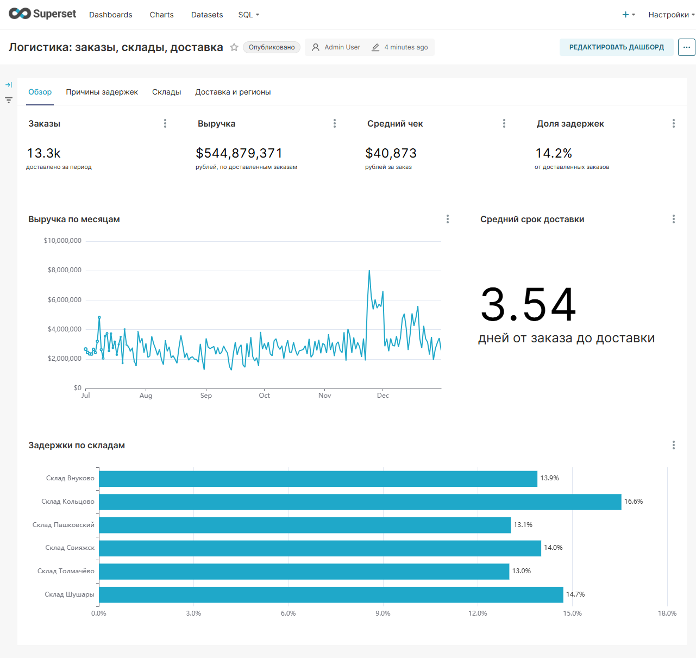
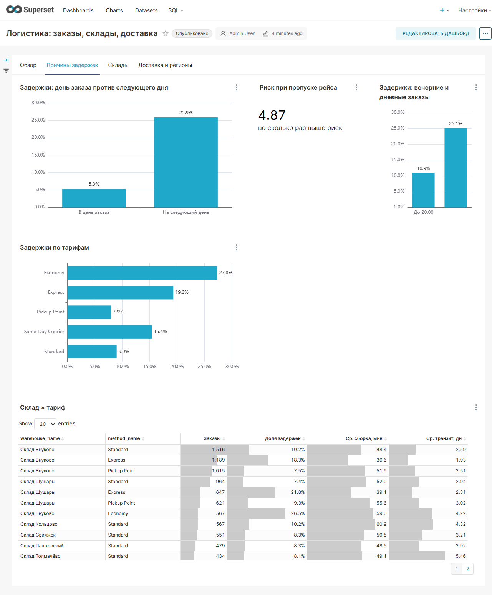
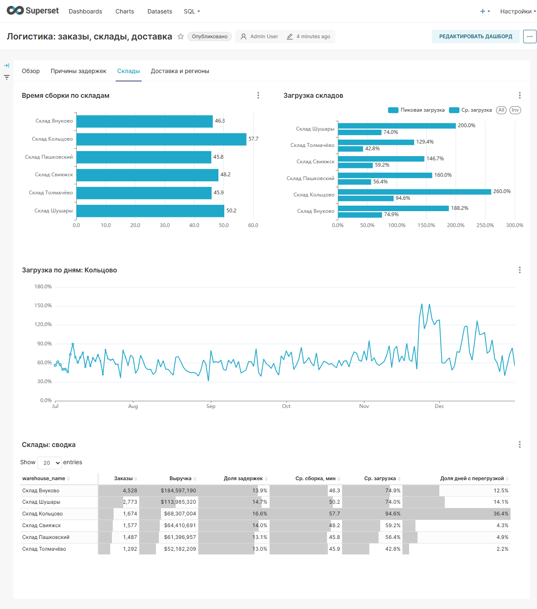
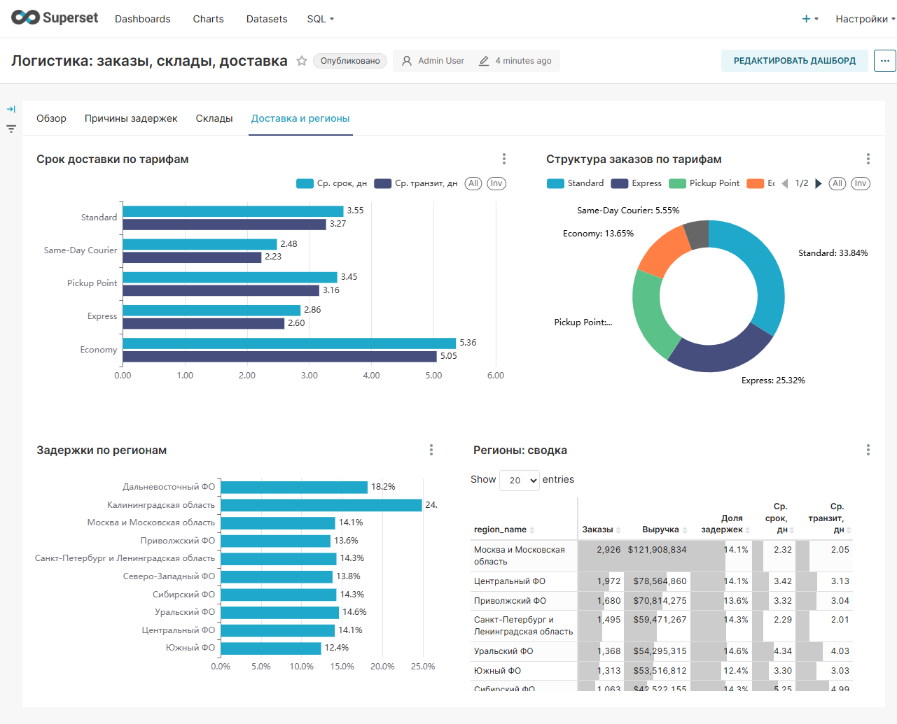

# Warehouse & Logistics Analytics

Аналитический проект для e-commerce компании: почему заказы приходят с
опозданием, какой склад тормозит доставку и что менять в первую очередь.

**Стек:** Python (pandas, NumPy, Faker) → PostgreSQL (SQL, views, индексы) →
**Apache Superset** (интерактивный дашборд) → scipy (проверка гипотез).

<p align="center">
  
</p>

---

## Главный вывод

Задержки вызваны не медленной работой склада, а **пропуском вечернего рейса**.

| Наблюдение | Значение |
|---|---|
| Сборка и упаковка в общем цикле склада | менее **15%** |
| Время, когда заказ просто ждёт рейс | **55%** |
| Риск задержки при отгрузке на следующий день | в **4,87 раза** выше |
| Задержки при отгрузке в день заказа | **5,3%** |
| Задержки при отгрузке на следующий день | **25,9%** |
| Доля задержанных заказов, отгруженных не в день оформления | **78,8%** |
| Средняя сборка: задержанные против вовремя доставленных | 49,9 против 48,5 мин |

Сборка у задержанных и у доставленных в срок заказов практически одинаковая.
Значит, ускорять сборку бессмысленно — нужно менять расписание рейсов
и расшивать узкий склад.

---

## Дашборд в Superset

Дашборд **«Логистика: заказы, склады, доставка»** — четыре вкладки,
двадцать чартов. Собран скриптом, а не руками в интерфейсе.

### Обзор

<p align="center">
  
</p>

Четыре карточки KPI, выручка по месяцам, средний срок доставки и рейтинг
складов по доле задержек.

### Причины задержек

<p align="center">
  
</p>

Сравнение «отгрузка в день заказа против следующего дня» (5,3% против 25,9%),
карточка риска 4,87×, эффект вечерних заказов, разрез по тарифам и таблица
«склад × тариф».

### Склады

<p align="center">
  
</p>

Время сборки по складам, средняя и пиковая загрузка относительно суточной
мощности, дневная динамика загрузки Кольцово и сводная таблица.

### Доставка и регионы

<p align="center">
  
</p>

Срок доставки по тарифам, структура заказов, задержки по регионам
и сводная таблица регионов.

---

## Структура проекта

```
warehouse-analytics/
├── .env.example                 # шаблон параметров PostgreSQL и Superset
├── docker-compose.yml           # PostgreSQL одной командой
├── docker-compose.superset.yml  # Superset поверх того же PostgreSQL
├── run_all.ps1                  # весь цикл одной командой
├── requirements.txt
├── database/
│   └── schema.sql               # DDL: таблицы, ограничения, индексы, views
├── generator/
│   └── generate_data.py         # генератор синтетических данных
├── etl/
│   └── load_data.py             # создание схемы и загрузка CSV в PostgreSQL
├── data/
│   ├── raw/                     # сгенерированные исходные CSV
│   ├── processed/               # очищенные данные
│   └── powerbi/                 # витрины «звезда» для BI
├── sql/
│   ├── 01_overview.sql          # общие KPI
│   ├── 02_warehouse.sql         # анализ складов
│   ├── 03_delivery.sql          # доставка и регионы
│   ├── 04_business_analysis.sql # причины задержек
│   └── run_queries.py           # запуск SQL-файлов из Python
├── analytics/
│   ├── analysis.py              # графики, гипотезы, витрины
│   └── data_quality.py          # проверки качества данных
├── superset/
│   ├── build_superset.py        # подключение БД и регистрация датасетов
│   ├── build_metrics.py         # 50 метрик с форматами d3
│   ├── build_dashboard.py       # 20 чартов, раскладка, экспорт
│   ├── metrics.py               # описания метрик
│   ├── superset_api.py          # клиент REST API
│   ├── superset_config.py
│   ├── Dockerfile
│   └── assets/                  # экспорт дашборда и датасетов
├── powerbi/
│   └── dax_measures.dax         # DAX-аналоги метрик
├── docs/
│   ├── business_requirements.md
│   ├── data_model.md
│   ├── key_findings.md
│   ├── powerbi_guide.md
│   ├── recommendations.md
│   └── images/                  # скриншоты дашборда
└── reports/
    ├── figures/                 # 12 графиков PNG
    └── hypothesis_tests.csv     # результаты статистических тестов
```

---

## Данные

Синтетический датасет за **1 июля — 31 декабря 2025**:

| Сущность | Объём |
|---|---|
| Заказы | 13 805 |
| Доставленные | 13 331 |
| Позиции заказов | 28 567 |
| Склады | 6 |
| Регионы | 10 |
| Способы доставки | 5 |
| Товары | 224 в 14 категориях |
| Сотрудники | 26 |

Данные генерируются с заложенными зависимостями: загрузка склада влияет
на время сборки, время оформления — на вероятность попасть на рейс, тариф —
на транзит. Готовых результатов анализа в генераторе нет: все выводы получены
запросами.

---

## Запуск

### Быстрый способ

```powershell
.\run_all.ps1
```

Скрипт выполняет пять шагов и печатает прогресс. Повторный запуск безопасен:
загрузчик делает `TRUNCATE` перед вставкой, строки не дублируются.

```powershell
.\run_all.ps1 -SkipGenerate   # без перегенерации данных
.\run_all.ps1 -SkipLoad       # без загрузки в БД
```

> Нужен PowerShell 5.1 или новее. Файл сохранён в UTF-8 с BOM, иначе
> PowerShell 5.1 читает кириллицу как ANSI и падает с ошибкой разбора.

### Пошагово

```bash
# 1. Окружение
python -m venv .venv
.venv\Scripts\activate
pip install -r requirements.txt

# 2. База
cp .env.example .env
docker compose up -d

# 3. Полный цикл
python generator/generate_data.py
python analytics/data_quality.py
python etl/load_data.py
python sql/run_queries.py
python analytics/analysis.py
```

Порядок важен: `data_quality.py` формирует очищенные CSV, из которых
`load_data.py` наполняет базу. Запуск загрузки до очистки загрузит «грязные» данные.

### Дашборд Superset

```bash
docker compose -f docker-compose.superset.yml up -d --build

python superset/build_superset.py    # подключение БД и датасеты
python superset/build_metrics.py     # 50 метрик с форматами
python superset/build_dashboard.py   # 20 чартов и дашборд
```

Дашборд: **http://localhost:8088** — `admin` / пароль из `SUPERSET_ADMIN_PASSWORD`.

Все три скрипта идемпотентны: создают объекты, а у существующих обновляют
параметры. Правка метрики в `metrics.py` и повторный запуск применяют изменение
к уже собранному дашборду.

---

## Что должно получиться

| Артефакт | Путь |
|---|---|
| Дашборд Superset | `http://localhost:8088/superset/dashboard/1/` |
| Экспорт дашборда | `superset/assets/dashboard_export.zip` |
| Графики (12 PNG) | `reports/figures/` |
| Результаты гипотез | `reports/hypothesis_tests.csv` |
| Отчёт качества данных | `data/processed/quality_report.csv` |
| Витрины для BI | `data/powerbi/` |

Признак успешного прогона — в консоли `Проверка целостности` со всеми `[OK]`
и `Графиков сохранено: 12`.

---

## Таблицы и связи

Полная ER-диаграмма — `docs/data_model.md`. Кратко:

- `orders` — заголовок заказа: склад, регион, тариф, сумма, обещанный срок;
- `order_items` — позиции заказа (`1:N` к `orders`, `N:1` к `products`);
- `shipments` — исполнение заказа (`1:1` к `orders`) с шестью временными отметками;
- `warehouses` — склады с суточной мощностью и нормативом сборки;
- `regions` — регионы с плановым транзитом;
- `delivery_methods` — тарифы и их стоимость;
- `products` / `categories` — товарный справочник;
- `employees` — сотрудники складов.

`shipments` вынесена из `orders`, чтобы хранить этапы процесса отдельно;
`CHECK`-ограничения запрещают нарушение порядка временных отметок;
денежные поля — `NUMERIC`, а не `FLOAT`.

---

## Основные SQL-операции

| Операция | Где используется |
|---|---|
| `JOIN` (в т.ч. `LEFT`) | сборка фактов заказа со справочниками |
| `GROUP BY` + агрегаты | KPI по складам, регионам, тарифам |
| `FILTER (WHERE ...)` | условные счётчики без подзапросов |
| `CASE` | бакеты загрузки, окна времени, категории причин |
| `DATE_TRUNC`, `EXTRACT` | дневная и месячная динамика, часы |
| `INTERVAL` / разница timestamp | сборка, транзит, внутренний цикл |
| `WINDOW` функции | ранжирование складов, доля от общего |
| `CTE` | пошаговые расчёты в `04_business_analysis.sql` |
| `VIEW` | слой семантики для Superset и Power BI |
| `PERCENTILE_CONT` | медиана времени сборки |

---

## Расчёт KPI

| KPI | Формула |
|---|---|
| Total Orders | `COUNT(*)` по `orders` |
| Revenue | `SUM(total_amount)` по доставленным |
| Average Order Value | `Revenue / delivered_orders` |
| Average Picking Time | `AVG(picked_at - picking_started_at)` в минутах |
| Average Delivery Time | `AVG(delivered_at - order_created_at)` в днях |
| On-Time Delivery Rate | `доставлено не позже promised_date / доставлено` |
| Delay Rate | `доставлено позже promised_date / доставлено` |
| Warehouse Utilization | `заказов за день / daily_capacity` |
| Internal Cycle | `AVG(shipped_at - order_created_at)` в часах |

Задержкой считается только опоздание: `delivered_at::date > promised_date`.
Ранняя доставка считается выполненной в срок.

---

## Как устроен BI-слой

Superset и Power BI читают **одни и те же views**, поэтому числа в дашборде,
в SQL-отчётах и в модели совпадают.

Семь датасетов:

| View | Что внутри |
|---|---|
| `vw_order_facts` | плоский факт заказа: сроки, задержка, выручка |
| `vw_warehouse_performance` | KPI по складам: сборка, загрузка, доля задержек |
| `vw_delivery_performance` | KPI по тарифам |
| `vw_regional_performance` | KPI по регионам |
| `vw_warehouse_daily_load` | загрузка склада по дням |
| `vw_daily_orders` | дневная динамика заказов |
| `vw_sla_analysis` | разрез «склад × тариф» |

Views намеренно не фильтруют по датам: срез задаётся в BI, чтобы не дублировать
логику в двух местах.

### Метрики и форматы

Пятьдесят метрик описаны в `superset/metrics.py` вместе с форматом d3. Формат
задан на уровне метрики, а не чарта: иначе одна и та же величина в карточке
и в таблице выглядела бы по-разному.

### Грабли, которые пришлось решить

- **Доли хранятся в процентах.** Во views `delay_rate` — это 0–100, а формат
  `.1%` ждёт долю от единицы. Без деления на 100 чарт показывает 1389%
  вместо 13,9%.
- **Чарты не обновлялись.** Скрипт пропускал существующие чарты, поэтому правка
  формата не доезжала до Superset. Теперь существующие объекты обновляются.
- **Кэш отдавал старые числа.** У чартов `cache_timeout = 0`: данные меняются
  скриптом, кэш только мешает.
- **Вкладки падали.** В `position_json` у вкладок был лишний `meta.text`,
  из-за чего дашборд зависал на спиннере.

### Power BI

Меры-аналоги лежат в `powerbi/dax_measures.dax`, пошаговая сборка отчёта —
`docs/powerbi_guide.md`. Данные можно взять тремя способами: прямое подключение
к PostgreSQL (views), CSV-витрины из `data/powerbi/` или DAX-меры поверх
импортированных таблиц.

Модель — «звезда»: `fact_orders` (13 331), `fact_warehouse_load` (1 103),
измерения `dim_warehouse`, `dim_delivery_method`, `dim_region`, `dim_date`
и готовые агрегаты `agg_*` для статичных карточек.

Файл `.pbix` в репозиторий не входит: бинарный, десятки мегабайт, бесполезен
в diff. Воспроизводимость даёт скрипт плюс инструкция.

---

## Какие бизнес-вопросы отвечает проект

1. Сколько заказов и какая выручка?
2. Какие склады загружены сильнее и работают медленнее?
3. Сколько времени занимает сборка и сколько — доставка?
4. Где именно внутри склада теряется время?
5. Какие регионы доставляются хуже и почему?
6. Какие способы доставки эффективнее?
7. Есть ли связь между загрузкой склада и задержками?
8. Влияет ли время оформления заказа на SLA?
9. Где основные узкие места процесса?
10. Что делать бизнесу в первую очередь?

Ответы: `docs/key_findings.md` (десять findings с цифрами) и
`docs/recommendations.md` (пять приоритетов и что делать не нужно).

---

## Проверка гипотез

Шесть гипотез проверены статистически (`scipy`), все подтверждены при p < 0,001:

| Гипотеза | Метод | Результат |
|---|---|---|
| Перегрузка склада повышает задержки | χ² | 20,27% против 12,49% |
| Время сборки растёт с загрузкой | Спирмен | ρ = 0,38 |
| Заказы после 20:00 опаздывают чаще | χ² | 25,06% против 10,92% |
| Economy хуже Standard | χ² | 27,32% против 8,98% |
| Удалённые регионы ждут дольше | Манн-Уитни | 8,12 против 3,33 дня |
| В пики задержек больше | χ² | 18,46% против 12,60% |

Результаты: `reports/hypothesis_tests.csv`.

---

## Визуализации

`reports/figures/` — двенадцать графиков из `analysis.py`:

| Файл | Содержание |
|---|---|
| `01_revenue_monthly.png` | выручка по месяцам |
| `02_orders_weekly.png` | недельная динамика заказов |
| `03_warehouse_performance.png` | сборка, загрузка, доля задержек |
| `04_load_vs_delay.png` | связь загрузки с задержками |
| `05_methods_delay.png` | задержки по способам доставки |
| `06_regions.png` | срок и задержки по регионам |
| `07_sla_heatmap.png` | heatmap «склад × способ доставки» |
| `08_stage_breakdown.png` | разложение внутреннего цикла |
| `09_delay_distribution.png` | отклонение от обещанного срока |
| `10_hour_effect.png` | влияние часа оформления |
| `11_categories.png` | топ-10 категорий по выручке |
| `12_delay_causes.png` | механизм задержки: отсечка рейса |

---

## Ограничения

- Данные синтетические; проект демонстрирует методику, а не реальный бизнес.
- Не моделируются себестоимость, возвраты и маржа.
- Не считаются штрафы за срыв SLA и стоимость хранения.
- Оценки эффекта рекомендаций расчётные, на исторических данных.
- Причинность подтверждена статистически, но не экспериментом: для окончательных
  выводов нужен A/B (см. раздел «Как проверить» в рекомендациях).

---

Учебный проект уровня Junior Data Analyst для портфолио.
